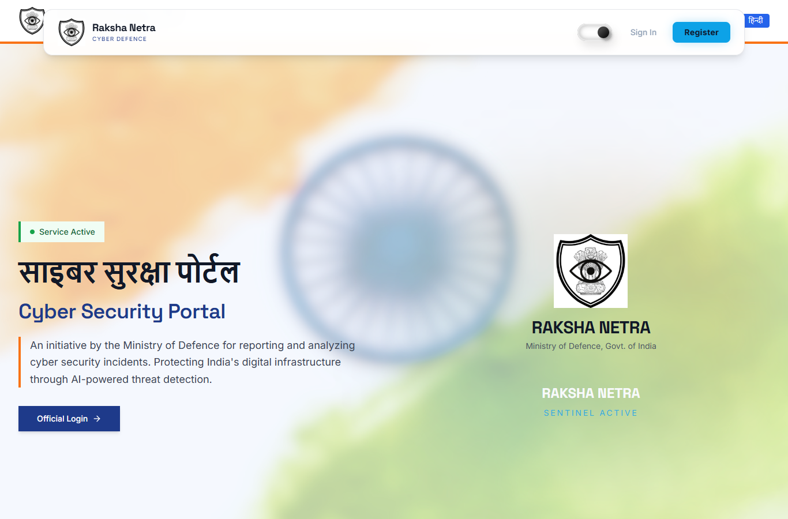
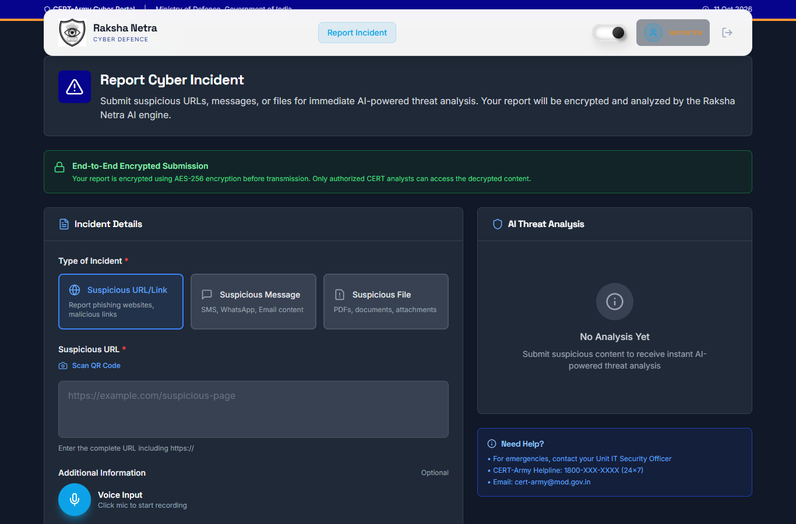
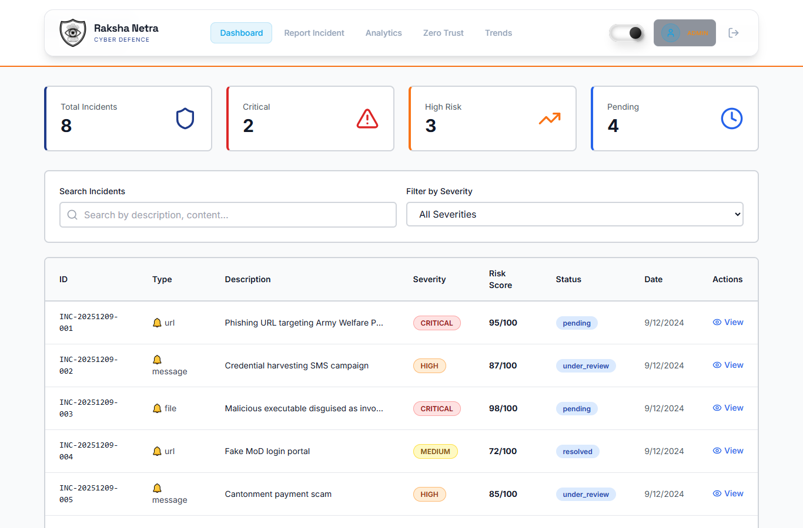
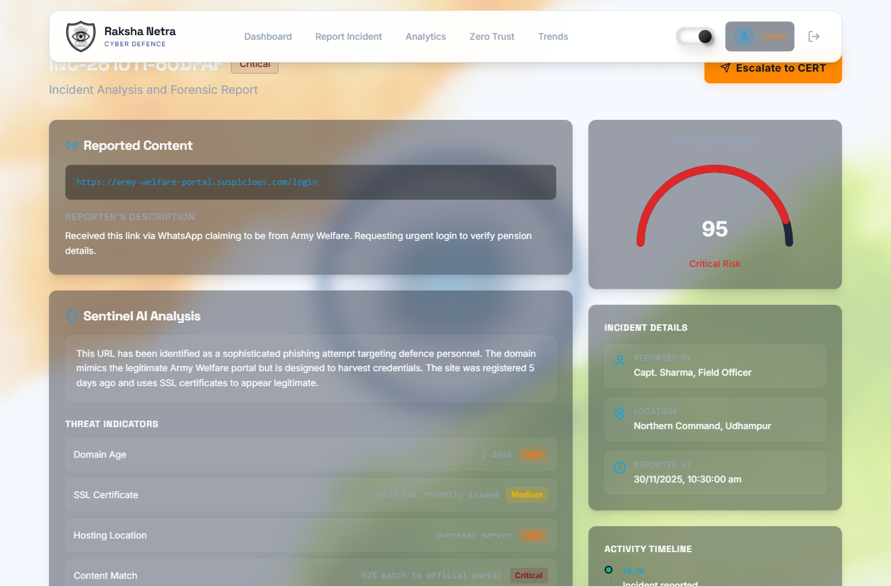
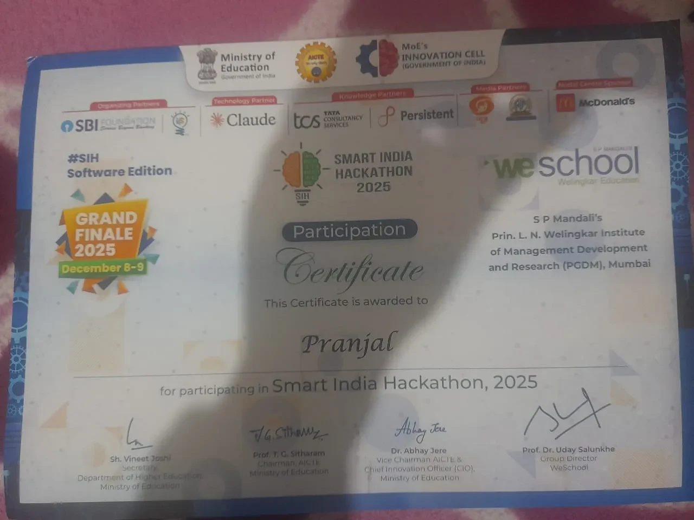

# WatchTower (Raksha Netra)

A cyber incident reporting portal built at Smart India Hackathon 2025 (problem statement SIH25183, Team Urban Dons). Our team took it to the Grand Finale, held on 8 and 9 December 2025.

Defence personnel submit a suspicious URL, message or file. The backend scores it, flags repeat threats, maps the report to a region and escalates the high-risk ones. Admins see the full analysis, while reporters only get a confirmation.

This repository holds the public write-up. The source code is in a private repository.

> WatchTower is a hackathon prototype. It is not an official Ministry of Defence or CERT-Army service, and it was never deployed for real use. The government names and contact details in the screenshots are placeholders that came with the problem statement's theme.



## What it does

- **Report an incident.** A reporter picks URL, message or file, adds optional notes, a location and voice input, and submits.
- **Analyse it.** The backend asks Google Gemini for a structured verdict: risk score, severity, threat type, indicators and recommendations. If the model is unavailable, a rule-based fallback scores the report instead. URLs also get a DNS lookup and a trusted-domain check, and uploaded files get a pattern-based static scan.
- **Add context.** It checks message text for signs of a fake Army profile, looks for similar earlier incidents, maps the location to an Army command region, and escalates automatically based on score, repeat count and military relevance.
- **Show it.** There are pages for an admin dashboard, incident details, analytics, trends and a zero-trust panel, with English and Hindi text.

| Report form | Admin dashboard |
| --- | --- |
|  |  |



## How it is built

Two processes talk over HTTP: a React single-page app and a FastAPI server.

```
Browser (React + Vite)
   |  JSON and multipart form
   v
FastAPI server
   |-- analysis pipeline   -> incident store
   |-- static file scan    -> evidence store
   |-- geo + repeat-threat matching
   '-- Google Gemini (optional)
```

- **Frontend:** React 18, TypeScript, Vite, Tailwind CSS, shadcn/ui, React Router and i18next.
- **Backend:** Python 3.11 and FastAPI, with SQLite for storage. The analysis pipeline is a chain of small modules: URL checks, Gemini analysis with a rule-based fallback, file scanning, fake-profile detection, repeat-threat matching, region mapping and auto-escalation.

[docs/ARCHITECTURE.md](docs/ARCHITECTURE.md) walks through the pipeline step by step.

## What is real and what is demo

This was built in hackathon time, so some screens are staged:

- The dashboard, analysis and incident-detail screens render a fixed set of eight sample incidents. Real submissions are stored by the backend but do not show up there.
- The landing page stats ("10K+ threats neutralized" and similar) are placeholder copy. Nobody measured them.
- The "AES-256 end-to-end encryption" banner on the report form describes a planned feature. The submission path does not encrypt reports.
- Gemini's risk scores are used as returned. Nothing checks them for accuracy.
- File scanning is pattern matching. It does not run files in a sandbox.
- Security is prototype-grade. The code was not hardened or reviewed for production, which is one more reason it stays private.

The parts that do run end to end are the report form, the backend pipeline, storage, and the API that reads stored incidents back.

## My part

I was the team leader. I built the portal and the analysis pipeline, everything except the news-pulling feature, which another team member wrote.

The original repository was created on my teammate Chandan Kumar's account ([@Chandankumar775](https://github.com/Chandankumar775)), and the first commits are under his name because I wrote that code on his laptop. The private copy keeps that history as it was and is held with his agreement.

## Certificate



## Licence

No licence is granted. Default copyright applies, so nothing here may be reused without permission. Open an issue if you would like to ask.
